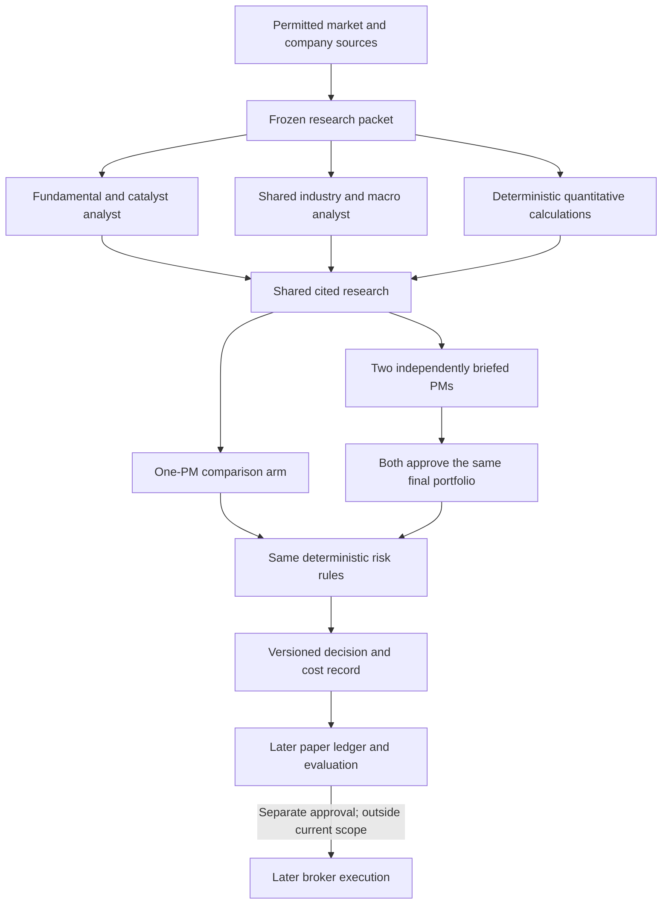

# Neutralis equities: an investment desk with measurable decisions

Working co-head synthesis, September 7, 2026. This describes the trading side for Constantine and Gaspar. All strategies remain research proposals; no performance experiment has run. It preserves the separately accepted arbitrage and Robinhood connection boundaries.

The useful part of a hedge-fund-style architecture is accountable specialization: analysts assemble attributable evidence, a portfolio manager proposes a portfolio, another manager challenges it, and ordinary software enforces the mandate. The structure makes decisions inspectable. Whether it improves returns is a separate hypothesis that must earn its cost.

The research packet is shared; private founder accounts and comparison-arm holdings stay separate. Analysts never hold credentials or order tools. The committee cannot quietly become a one-PM system when a manager disagrees or is unavailable. A proposed sell, trim or exit needs the same approvals as a buy. Emergency exits require their own explicit mandate; none is being added here.

## What deserves investigation

| Proposal | Reason to investigate | What must still be demonstrated |
| --- | --- | --- |
| Existing monthly momentum plus gross profitability | Published evidence supports these as distinct historical signals. The combination is a concrete existing Neutralis proposal. | Point-in-time tradable identities, original financial vintages, delisting/actions, realistic turnover/costs, untouched evaluation. Long-short academic results do not establish our long-only implementation. |
| A fixed broad-equity ETF trend/cash comparator | Much smaller input burden and almost no ongoing language-model work. Useful for asking whether complexity earns its keep. | Freeze the instrument, exact signal, warm-up, execution delay, distribution/cash accounting and cost conventions before outcomes. It is not an automatic overlay or adopted strategy. |
| Forward paper investment-team experiment | Closest to the requested product. Decisions can be frozen before subsequent observations, reducing dependence on historical model knowledge. | Compare one PM and two PMs using the same research and controls, separate paper holdings, complete costs and passive references. A short pilot primarily proves process, not persistent alpha. |

The [concrete Fable ETF proposal](artifacts/ETF-trend-comparator-v4.md) fixes SPY, a month-end comparison with the exact 200-session mean, zero-interest cash and next-session official-open paper observations. [Root planning acceptance](reviews/ETF-comparator-planning-settlement.md) preserves the remaining source, action-coverage, constant-mix sizing and evaluation gaps; it authorizes no run.

The [primary-source evidence review](EQUITIES-STRATEGY-EVIDENCE-20260907.md) records study periods, costs, qualifications and failures. High-turnover news strategies are particularly sensitive to execution costs. Recent agent-team demonstrations do not isolate the benefit of a second PM and often have short evaluation windows. One prominent financial-statement LLM paper was withdrawn; it is excluded as positive evidence. The screenshot showing Dr. Lira's +143.5% portfolio supplies no return period, benchmark, drawdown or fee attribution; it cannot settle our strategy choice.

## What the comparison can answer

A two-PM versus one-PM comparison measures the incremental committee stage given the same research. It does not by itself measure whether analysts add value, or whether models outperform deterministic investing. Passive and numerical strategy references answer different questions and must stay visible. Different model families can still share training data, assumptions and mistakes; their agreement is not statistical independence.

There are two distinct comparisons. First, report each workflow as designed, including its actual extra calls and cost. Second, if later commissioned, compare workflows under an equal model-spending allowance. Giving the committee more computation and observing a difference cannot identify organization alone as the cause. Do not quietly add extra discussion rounds or choose the best model after seeing returns.

Before any outcome is observed, freeze the decision schedule, universe, sources, mandate, model/prompt identifiers, missing-input handling and execution convention. Preserve rejected and missed decisions as well as accepted ones. Log operational outcomes such as unsupported factual claims, stale packets, disagreements and cost overruns separately from investment returns. They show process quality, not profitability. Cost per admitted/rejected decision sits alongside annual incremental and allocated overhead. Any exposure-matched passive control must freeze its weight from the development period and keep it fixed through validation and final evaluation; future exposure cannot choose that control.

No annualized Sharpe, confidence interval or backtest is produced by EQ001. Related stocks and overlapping holding periods are not independent samples. A longer, separately specified evaluation needs a statistical design suited to its actual return sequence and portfolio dependence; a fixed number of weeks does not create certainty.

## The cost hurdle

Using Constantine's illustrative $20 Railway plus $25 Supabase, allocating the entire $45 monthly baseline to equities would cost $540 a year before data, model calls and trading friction. Actual bills and allocation remain unverified. Incremental equities costs are currently unknown; the table isolates only the hypothetical full allocation of the quoted hosting baseline.

| Illustrative capital, not a funding recommendation | $540 annual overhead divided by capital |
| --- | ---: |
| $5,000 | 10.80% |
| $10,000 | 5.40% |
| $25,000 | 2.16% |
| $50,000 | 1.08% |

These are simple annual cost ratios, not expected returns or exact compounded break-even performance. The proper question is whether additional net performance over the relevant alternative can cover incremental and fairly allocated costs at acceptable risk. A positive gross return alone does not answer it. Data/model fees, failed calls, slippage and any costs of the alternative belong in the comparison. Shared research and hosting must never be charged twice.

The [interactive cost worksheet](artifacts/equities-cost-worksheet.html) lets the founders change capital, allocation and hypothetical fees locally; blank fees remain unknown rather than claiming a complete zero-cost estimate.

That argues for bounded on-demand research before continuous cloud jobs. Do not purchase a large historical dataset merely to run a handful of prospective ETF decisions. Conversely, do not describe current broker quotes as a substitute for the survivor-aware, original-vintage history needed by the separate factor test.

## Concrete progress and next gates

[EQ001](tasks/EQ001-investment-desk-foundation.md) is the reviewed first build contract: synthetic packet and citation validation, complete portfolio proposals, roster-bound approvals, deterministic risk checks and honest cost records. Fable's two material ticket corrections were incorporated. Conductor's WAF rejected dispatch, so implementation has not started. The saved complete ticket remains reviewable; no alternate writer has been launched.

[RH002 candidate02](artifacts/rh002-candidate-02/RH002-investment-team-feasibility.md) is fully imported at bcb63a2, read in full by Astra and accepted after the same Fable reviewer’s [whole-artifact PASS](reviews/RH002-candidate-02-fable.md). It corrects PM input budgets to carry the complete memo packet: 556,000 input and 41,800 output tokens for the illustrative 50-call comparison, with no assumed cache discount. It does not connect Robinhood. Real client approval, onboarding, schemas and research-data rights remain separate evidence gaps.

[Source feasibility](EQUITIES-SOURCE-FEASIBILITY-20260907.md) and [three ETF source combinations](ETF-SOURCE-OPTIONS-20260907.md) identify concrete gaps. Alpaca's documented older SIP access merits a precise rights/actions contract. Tiingo's useful action fields have material retention restrictions. Alpha Vantage's free daily window does not immediately supply long-lookback initialization. FRED's current archive/software-ML restrictions prevent assuming it is an admitted stored/model input. No provider is selected or paid.

The next useful investment decision is a capped, frozen paper protocol with verified inputs and a cost ceiling. The first foundation can establish that decisions are reproducible and controls work. Conviction in a strategy will require subsequent evidence that survives costs, simple controls and new observations.
